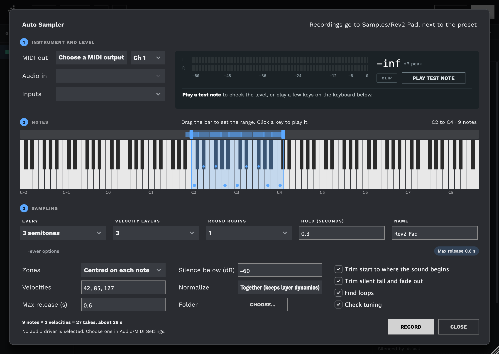
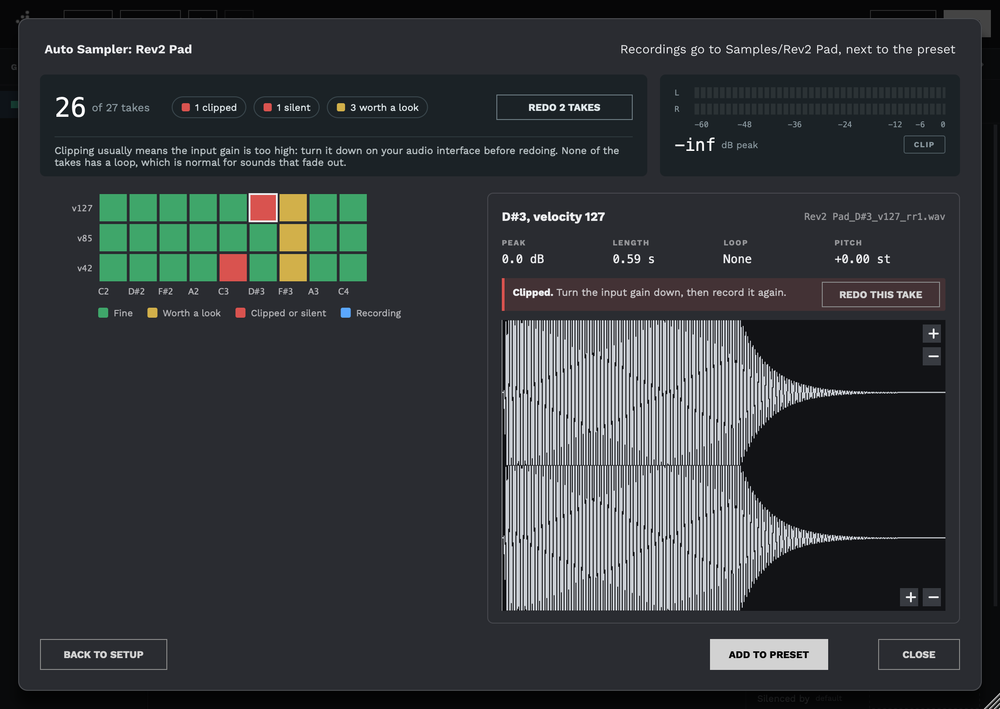

The Auto Sampler
================

The Auto Sampler records a hardware synthesizer or other external instrument, note by note, and turns the recordings into a playable preset. You choose which notes to sample, how many velocity layers and round robins you want, and how long to hold each note. Decent Sampler then plays each note over MIDI, records what comes back through your audio interface, trims and loops the recordings, and adds them to the preset you're editing as ordinary groups and samples.

It lives in the [Preset Editor](the-preset-editor.md), under **TOOLS... > Auto Sampler...**.

## What you need

- **The Decent Sampler app on a Mac or Windows computer.** The Auto Sampler uses the app's own audio and MIDI devices, so it isn't available in the plugin, on Linux or on iOS.
- **An instrument you can play over MIDI**, connected to a MIDI output of your computer.
- **An audio input** that the instrument's output is plugged into, usually an audio interface.

Choose the audio interface under **Options > Audio/MIDI Settings** in the app's window first. On a Mac, the first time you use the Auto Sampler, macOS asks whether Decent Sampler may use the microphone. Say yes, since that permission covers every audio input.

While the Auto Sampler window is open, it has the audio and MIDI devices to itself, so Decent Sampler itself is silent until you close it.

## The Setup page

The page reads from top to bottom, in the order you work.

### 1. Instrument and level

- **MIDI out** is the MIDI output that reaches your instrument, with the MIDI channel it listens on.
- **Audio in** and **Inputs** are the audio device and the inputs the instrument is plugged into: a stereo pair, or a single input for mono.
- **PLAY TEST NOTE** plays a note and measures what comes back. It tells you whether the level is good, too quiet or clipping, and sets the silence level from the noise it hears. If nothing comes back, check the MIDI channel, the cables and the audio input.

Set your instrument's volume, or the input gain on your audio interface, so the loudest notes peak well below 0 dB. Any take that clips is marked so you can record it again.

### 2. Notes

The keyboard shows which notes will be recorded, marked with dots. Drag the ends of the bar above it to set the lowest and highest note, or drag the middle of the bar to move the whole range. Clicking the bar outside the range moves the nearer end there. Clicking a key plays that note on your instrument, which is handy for finding its range.

Middle C is C3, as everywhere else in Decent Sampler.

### 3. Sampling

- **Every** sets how far apart the sampled notes are: every note, every 2, 3, 4 or 6 semitones, or every octave. Each recording plays across the notes around it, so sampling fewer notes saves time at the cost of more pitch-shifting.
- **Velocity layers** sets how many velocities each note is recorded at. They are spread evenly, for example 42, 85 and 127 for three layers.
- **Round robins** records each note and velocity up to 4 times, so repeated notes don't sound identical.
- **Hold (seconds)** is how long each note is held before its note-off.
- **Name** names the recordings and the groups they become.

The line at the bottom adds it up, for example "9 notes × 3 velocities = 27 takes, about 28 s". The time allows for each note's release to ring out fully, so a session usually finishes sooner.

**More options** has the rest. Any setting you change from its default is listed beside the button, so you can see it even with the options closed.

- **Zones** decides which way each recording stretches to cover the notes between the sampled ones: **Centred on each note**, **Upward from each note** or **Downward from each note**.
- **Velocities** sets the exact velocities of the layers, for example `30, 80, 127`.
- **Max release (s)** is the longest the Auto Sampler waits after the note-off for the sound to die away.
- **Silence below (dB)** is the level counted as silence, for trimming and for deciding when a release has finished. Playing a test note sets it for you.
- **Normalize** sets every sample's volume so they reach a common level, without changing the recordings. **Together** sets one volume from the loudest take, so the difference between velocity layers is kept. **Each sample** brings every take up to the same peak. **Off** leaves them as recorded.
- **Folder** chooses where the recordings go (see below).
- **Trim start to where the sound begins** removes the silence before each note, keeping a few milliseconds so the attack isn't cut.
- **Trim silent tail and fade out** removes the silence after the release and fades out the end.
- **Find loops** looks for a loop in sounds that sustain, such as pads and organs. Sounds that fade away get no loop, which is normal.
- **Check tuning** measures each take's pitch and flags any that are noticeably out of tune.

The Auto Sampler remembers its settings between uses.

### Where the recordings go

By default, recordings go into the preset's `Samples` folder, in a folder named after the **Name** setting, for example `Samples/Rev2 Pad`. That's why the preset needs to be saved first. Alternatively, choose a folder under **More options**.

Each take is a 24-bit WAV file at your audio interface's sample rate, named after its note, velocity and round robin, for example `Rev2 Pad_E3_v085_rr1.wav`. A loop that was found is saved in the file as well as in the preset.

## The Recording page

**RECORD** starts the session. The top of the page shows the note being recorded, the input level, and how much is left.

The grid has a square for every take, one column per note and one row per velocity layer:

- **Green** is fine.
- **Yellow** is worth a look, for example a take that seems out of tune, or one still sounding when **Max release** ran out.
- **Red** is clipped, or silent (nothing came back).
- **Blue** is being recorded.

Click a square to see that take: its peak level, length, loop and pitch, any problem found, and its waveform. **REDO THIS TAKE** records it again.

**PAUSE** stops after the current take, and **RESUME** carries on. **STOP** ends the session. If you record again later with the same settings and the same folder, it carries on where it stopped and doesn't repeat the takes it already has.

When the session ends, the top of the page becomes a summary. It shows how many takes were recorded and how many need attention, and has a **REDO** button for every clipped or silent take. Clicking one of the counts selects those takes in the grid.

## Adding the samples to the preset

**ADD TO PRESET** adds the recordings to the preset you're editing and selects the new groups:

- One group named after the **Name** setting holds every sample. With round robins there is one group per round robin, set up to take turns (`seqMode="round_robin"`; see [Round robins](the-preset-editor.md#round-robins)).
- Each sample gets its root note, its note and velocity range, its loop if one was found, and its volume from the **Normalize** setting.
- With several velocity layers, the groups get a low amp velocity tracking (`ampVelTrack="0.3"`), since the recordings already carry the instrument's dynamics. With a single layer it is left at full.

This is a single step that **Undo** reverses. The recordings stay on disk either way.

Everything that comes after is ordinary Preset Editor work: adjusting loops, adding an envelope or effects, building a user interface, and saving.

## Tips

- Set your instrument up so each note sounds the same every time: turn off arpeggiators, delays and reverbs, and any LFO that isn't synced to the note. You can add effects in Decent Sampler afterwards.
- If every take sounds an octave off, the instrument is transposed. The Auto Sampler tells you, and the preset will play back the same way, so fix it on the instrument and record again if you didn't mean it.
- Long releases and many layers add up quickly. Try a short range first to check the level and the settings, then record the whole instrument.
