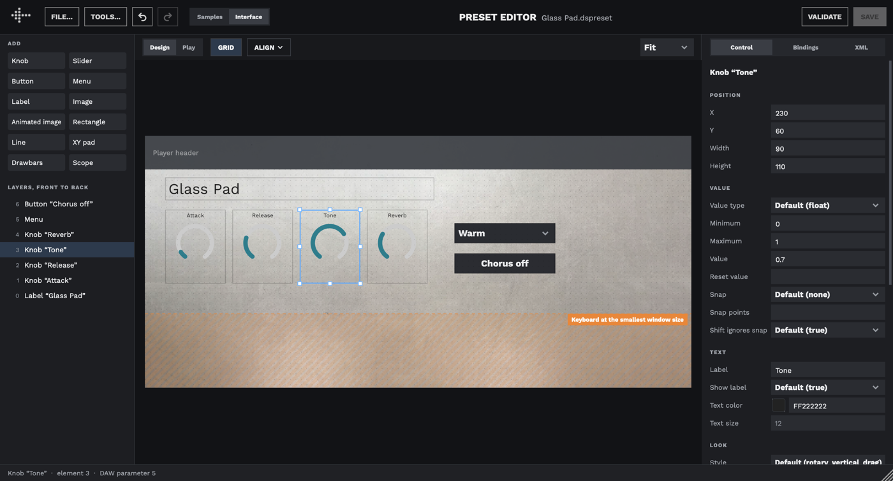

The UI Designer
===============

The UI Designer builds an instrument's interface visually: you add knobs, sliders, buttons, menus, labels and images, arrange them on a picture of the player, and choose what each control does. Everything it makes is ordinary XML in the preset's `<ui>` element, as described in [The &lt;ui&gt; element](the-ui-element.md), so you can switch between the designer and editing the XML by hand whenever you like.

The UI Designer was added in Decent Sampler 1.42.0.



## Opening the designer

The designer is part of the [Preset Editor](the-preset-editor.md). Open the Preset Editor (**File > Developer Tools > Preset Editor**, or **F12**), then click **Interface** on the **Samples / Interface** switch next to Undo and Redo. Click **Samples** to go back to the sample mapping.

Like the Preset Editor, the designer isn't available on iOS, or for copy-protected libraries.

Changes take effect in the preset as you make them, and the player shows them when you go back to it. Save the preset with **SAVE** as usual.

## The window

- **ADD**, at the top left, has one button for each kind of control. Click one to add it in the middle of the view, or drag it to where you want it.
- **Layers, front to back** lists everything in the interface. The number beside each one is its position in the `<tab>`, which is how bindings and MIDI mappings refer to it. Click a layer to select it, or right-click it for the same commands as on the canvas.
- **The canvas**, in the middle, shows the interface as the player draws it at its smallest window size: the background, the player's header above it, and an orange band where the on-screen keyboard covers the bottom of the interface (see [Leaving room for the keyboard](#leaving-room-for-the-keyboard) below).
- **The toolbar** above the canvas has **Design** and **Play**, **GRID**, the **ALIGN** menu, and the zoom: **Fit**, or 50% to 200%.
- **The inspector**, on the right, has three tabs: **Control**, **Bindings** and **XML**.
- **The status line**, along the bottom, names what's selected and its position, which MIDI CCs turn it, and which DAW parameter it is. If anything is under the keyboard, it says how many.

In **Play** mode the controls work as they do in the player: knobs turn, buttons switch state, and the bindings act on the sound, so you can try the instrument without leaving the designer. Switch back to **Design** to edit.

Keyboard shortcuts in this chapter are for the Mac. On Windows and Linux, use Ctrl where it says Cmd, and Alt where it says Option.

## Adding controls

The ADD palette has every kind of interface element:

| Button | Element |
|---|---|
| Knob | `<labeled-knob>` |
| Slider | `<labeled-knob>` with a linear `style` |
| Button | `<button>` |
| Menu | `<menu>` |
| Label | `<label>` |
| Image | `<image>` |
| Animated image | `<multiFrameImage>` |
| Rectangle | `<rectangle>` |
| Line | `<line>` |
| XY pad | `<xyPad>` |
| Drawbars | `<drawbars>` |
| Scope | `<oscilloscope>` |

A new control is added in front of everything else, at a size that matches the player's defaults. It doesn't do anything until you give it bindings (see [Choosing what a control does](#choosing-what-a-control-does)).

## Selecting, moving and resizing

- Click a control to select it. Shift-click or Cmd-click adds it to the selection, or takes it out. Drag across an empty part of the canvas to select everything the rectangle touches.
- **Cmd+A** selects everything, and **Esc** clears the selection.
- Drag a selected control to move it, or drag one of its handles to resize it. A line has a handle at each end instead.
- The arrow keys nudge the selection by one pixel, or by 10 with Shift.

While you drag, the edges and centers of the control snap to the edges and centers of the others, and a pink guide line shows what it lined up with. Where there's nothing to line up with, it snaps to an 8-pixel grid. Click **GRID** to turn the grid off, or hold Cmd while dragging to turn off both the grid and the guides.

To type exact values, use the **Position** fields at the top of the Control tab.

Every move or resize is one step for **Undo** (Cmd+Z), however far you dragged.

## Copying, deleting and arranging

The same commands are on the canvas's right-click menu:

- **Cmd+D** duplicates the selection. Holding Option while you drag drags copies, leaving the originals where they were.
- **Cmd+C**, **Cmd+X** and **Cmd+V** copy, cut and paste. Controls are copied as XML, so you can also paste them into a text editor, or copy an example from this guide and paste it into the designer. A paste accepts a single element, several, a whole `<tab>` or a whole `<ui>`.
- **Delete** (or Backspace) deletes the selection.
- **Cmd+]** and **Cmd+[** bring the selection forward or send it back one layer, and **Shift+Cmd+]** and **Shift+Cmd+[** bring it to the front or send it to the back.

**ALIGN** lines up the selected controls: **Align Left Edges**, **Align Centers**, **Align Right Edges**, **Align Top Edges**, **Align Middles** and **Align Bottom Edges**. **Space Evenly Across** and **Space Evenly Down** spread three or more controls out so the gaps between them are equal.

### What moving a control in the layer order changes

Several parts of a preset refer to a control by its position in the `<tab>`: MIDI CC mappings in the `<midi>` element (see [The &lt;midi&gt; element](the-midi-element.md)), and bindings that show, hide or change another control. When adding, deleting or reordering controls changes those positions, the designer updates all of these references for you, so they still reach the same controls.

Two things can't be updated, because they are stored outside the preset:

- **DAW automation.** Each knob is a DAW parameter (an XY pad is two), numbered in the order they appear in the interface, and a DAW records automation by that number. Moving a knob in the layer order changes which knob a song's automation moves.
- **Saved [snapshots](topic-snapshots)** of the instrument's settings, which also store control values by their order.

The first time an edit would change these for a preset, the designer tells you which controls are affected and asks before going ahead. Deleting a control that something else still refers to, such as a MIDI CC or a button that shows and hides it, also asks first, and lists what would be left controlling nothing.

## The Control tab

The Control tab shows every setting of the selected control, grouped into **Position**, **Value**, **Text**, **Look** and **Behavior**. Settings you haven't set show the value the player uses for them, dimmed, or **Default (…)** in a menu. Change one and it's written to the XML; choose the default again to remove it.

With several controls selected, the tab shows the settings they have in common, and a change applies to all of them.

Colors can be typed as eight-digit hex values (see [The color format](appendix-a-the-color-format.md)), or chosen by clicking the swatch beside them.

When nothing is selected, the tab shows the settings of the interface itself: its **Width** and **Height**, its background color and its background image.

### Images

Image settings, such as an image's file or the interface's background image, have a button for choosing the file. If you choose an image from outside the preset's folder, the designer copies it into an `Images` folder beside the preset and uses the copy, so the library still works when you share it.

## Choosing what a control does

A control does something through its bindings (see [Appendix B: The &lt;binding&gt; element](appendix-b-the-binding-element.md)). The **Bindings** tab lists them for the selected control, in plain words, with the parameter and mapping underneath.

```{image} _static/images/ui-designer-bindings.png
:alt: "The Bindings tab for a knob, under \"When it's turned\": Cutoff frequency of effect 0 (lowpass), scaled from 200 to 20000, and Resonance of effect 0 (lowpass), from 1.2 to 0.7. Each has an EDIT button and a remove button, with ADD BINDING underneath."
:width: 300px
```

Where the bindings live depends on the control:

- A **knob** or **slider** has one list, **When it's turned**. **Drawbars** work the same way.
- A **button** has a list for each of its states, which take effect when the button switches to that state.
- A **menu** has a list for each of its options.
- An **XY pad** has a list for its **X axis** and one for its **Y axis**.

Click **ADD BINDING** under a list to add one, or **EDIT** to change one. The editor walks you through it from top to bottom:

```{image} _static/images/ui-designer-binding-editor.png
:alt: "The binding editor: Controls set to An effect, Which set to Effect 0 (lowpass), Parameter set to Cutoff frequency (Hz), Mapping set to Scale to a range from 200 to 20000, Reversed set to No, with CANCEL and SAVE buttons"
:width: 300px
```

1. **Controls**: what kind of thing it changes: the instrument, a group, an effect, a group's effect, a modulator, a bus, a tag, another control, a note sequence or the arpeggiator.
2. **Which**: which one of them in this preset, by number and type, such as **Effect 0 (lowpass)**. If the preset has none, the menu says so; add one first, for example in the XML or with the standard controls and effects template under **TOOLS... > Templates**.
3. **Parameter**: what it changes, from the parameters that kind of thing has.
4. **Mapping**: how the control's value becomes the parameter's value:
   - **Pass the value straight through** uses the control's value as it is.
   - **Scale to a range** maps the control's range onto **From** and **To**. To go the other way, set From higher than To, or turn on **Reversed**.
   - **Set a fixed value** always sets the same value, which is what button states and menu options usually want, such as an effect turned on or off.
   - **Look it up in a table** uses a table of points, for a curve rather than a straight line.

**SAVE** adds the binding, as one Undo step. Settings of a binding that the editor doesn't show are kept as they were.

To check a binding, switch the canvas to **Play** and turn the control.

## The XML tab

The XML tab shows the selected control as XML, including its bindings. Edit it there and click **APPLY**, for anything the other tabs don't cover, or **REVERT** to throw your edits away. Apply is one Undo step, like any other change. With more than one control selected, the tab is empty; select one.

## Leaving room for the keyboard

The player draws its on-screen keyboard over the bottom of the interface. It doesn't get smaller when the window does, so at the player's smallest window size it covers more of the interface than at larger sizes. The designer shows the area it covers at the smallest size as an orange band. For the standard 812 x 375 interface, that's everything below y = 215.

Keep your controls above the band, so players can reach them at any window size. A background image or rectangle can run under it; that's normal. The designer outlines any control that reaches into the band in orange, and the status line counts them.

**VALIDATE** in the Preset Editor also warns about controls that:

- reach under the keyboard at the smallest window size (images, rectangles and lines aren't reported),
- run past the left, top or right edge of the interface, so part of them is cut off,
- start below the bottom of what the player ever shows of the interface.

Hidden controls aren't checked, since a binding decides when they appear. These warnings appear only in the Preset Editor's **VALIDATE**, not in **File > Developer Tools > Validate Preset**.

## Limitations

- The designer edits the first `<tab>` of the interface, which is the only one the player shows.
- Some settings, such as a knob's colors and style, are only read when the player builds its interface. The designer's canvas redraws with them straight away, and the player shows them when you go back to it.
